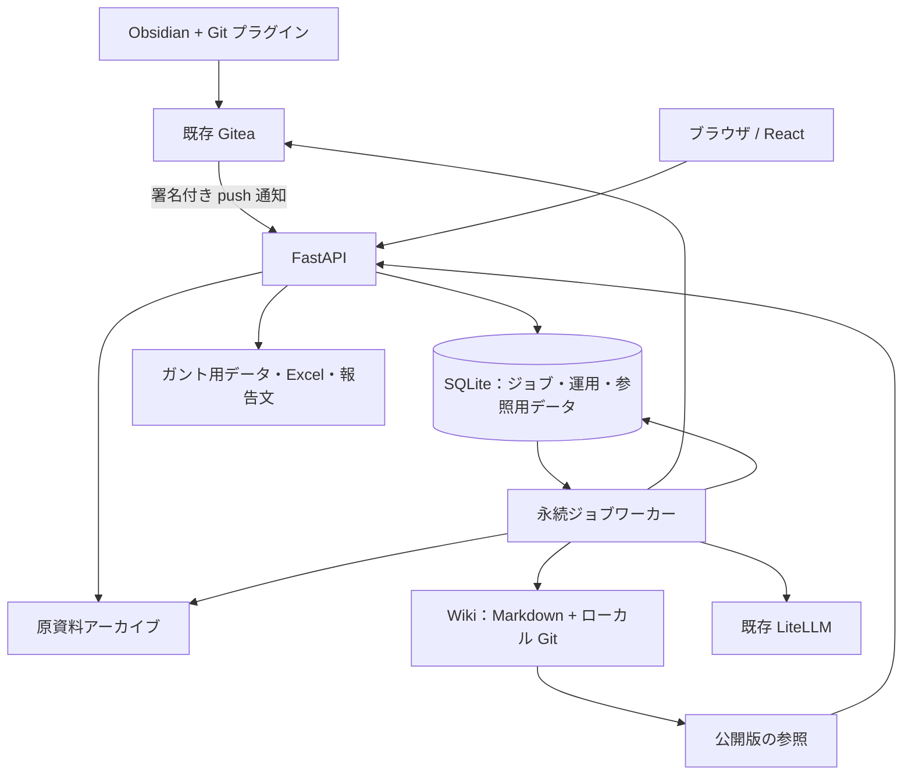
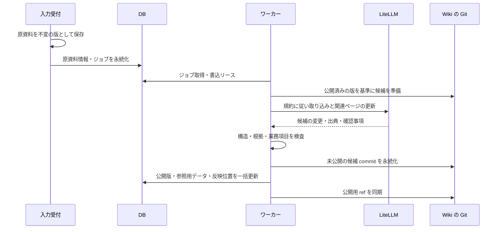

# 詳細設計書

対象：Our Context（仮称）。版：0.1。作成日：2026-11-01。状態：設計原案。実装方式は [実装構成](implementation.md)に記載する。

本書は[要件定義書](requirements.md)の初期版を実装するための設計案である。接続、性能、LLM の文章品質は設計時点では未検証である。

## 1. 基本方針

### 1.1 本家方式の採用範囲

LLM Wiki の運用は [Karpathy 本家](https://gist.github.com/karpathy/442a6bf555914893e9891c11519de94f)に従う。本書ではその原理を再設計しない。業務分野で重視する情報と、アプリとしての接続・画面・実行契約を定める。

運用規約には、タスク・プロジェクト・チームの文脈を参照すること、出典と時点を残すこと、確認事項の抽出基準、業務ツールに必要な情報を明記する。文書の分類や相互参照は本家方式の Wiki 運用に委ねる。

### 1.2 情報の基準

| 情報 | 保存先・扱い |
|---|---|
| 元メモ、回答、訂正、確定した変更 | 改変しない原資料として版ごとに保存する。 |
| 維持された業務知識、現在の整理 | バージョン管理された Wiki の Markdown を基準とする。 |
| タスク・案件・人物などの一覧 | Wiki から作る参照用 DB。再構築できる。 |
| 確認事項の回答待ち・保留状態 | ワークフロー DB。回答本文は原資料にも保存する。 |
| ジョブ、会話、認証、出力履歴 | 運用 DB。業務の事実を独立して保持する場所にはしない。 |

Wiki、一覧、ガント、質問回答、報告は公開済みの同じ版を参照する。DB の一覧だけを先に変更する実装は採用しない。

### 1.3 初期版と将来の境界

初期版は自分 1 人が利用する。人物の困りごとや所感は、自分が入力したメモや補足に含まれる範囲で扱う。将来、本人の入力、会議、外部の会話を追加できるよう、情報源・発言者・対象者・記録者・時点を分けて保存する。

## 2. システム構成



### 2.1 構成要素

| 要素 | 構成案 | 責務 |
|---|---|---|
| フロント | React + TypeScript + Vite | 常設画面、本文表示、質問、確認事項、予定、報告。 |
| API | FastAPI + Pydantic | 認証、入力検査、参照 API、ジョブ受付、イベント配信。 |
| ワーカー | 独立した Python プロセス | 取り込み、Wiki 更新、質問回答、点検、出力。 |
| LLM 接続 | httpx を使う LiteLLM 接続アダプター | モデルの選択、機能検査、ツール呼出、応答検証、利用量記録。 |
| 永続状態 | SQLite | 永続キュー、確認事項、会話、参照用データ、公開版の指定。 |
| Wiki | Markdown + ローカル Git | 完成した版の保存、差分、根拠、取り出し。 |
| ガント | React + SVG | 検証済みタスクデータから描画。AI が生成した HTML を実行しない。 |
| Excel | openpyxl | 標準 `.xlsx` を生成。 |
| 起動方式 | Docker Compose | API とワーカーを常駐し、永続ボリュームを共有する。 |

初期版の Wiki 書込ワーカーは 1 ワークスペースにつき 1 本とする。SQLite を永続キューに使い、プロセス内のバックグラウンド処理だけには依存しない。Redis、専用の検索・グラフサービスは必須にしない。

### 2.2 モジュール境界

| モジュール | 主な処理 |
|---|---|
| `auth` | 単一所有者のログイン、セッション、CSRF 検査。 |
| `connectors/gitea` | 署名検証、通知の重複排除、設定済みリポジトリの取得。 |
| `sources` | 原資料と版の保存、回答の受付、撤回イベント、出典の解決。 |
| `jobs` | ジョブの取得、リース、再試行、実行予算、状態通知。 |
| `wiki_runtime` | 本家方式の取り込み・質問・点検の実行、運用規約の読込。 |
| `publisher` | 候補版の検証、Git への保存、公開版と参照用 DB の切り替え。 |
| `projections` | Wiki から案件・人物・タスク・観察記録を読み出す。 |
| `questions` | 不足事項の整理、重複排除、回答待ち・保留の管理。 |
| `planning` | 予定の試算、変更案、依存関係と締め切りの検査。 |
| `reports` | 報告文、Excel、出力条件と参照版の保存。 |

## 3. 保存領域

実装用の配置案を示す。Wiki の分類は本家方式に従う。

```text
workspace/
  archive/
    raw/<source-id>/<revision-id>/
      content.md
      metadata.json
  knowledge/
    .git/
    AGENTS.md
    raw/<source-id>/<revision-id>.md
    raw/manifest.json
    wiki/
      index.md
      log.md
      <page>.md
  state/
    app.sqlite3
  builds/<job-id>/
  exports/<export-id>/
  backups/<backup-id>/
```

- `archive/raw` は、受付済み原資料の永続アーカイブである。Wiki 更新に失敗しても残る。
- `knowledge/raw` は、その Wiki 版に取り込んだ原資料の写しである。同一内容であることをハッシュで検査する。
- `raw/manifest.json` は、原資料の ID・版と、ファイル・取得元・出典位置を結び付ける。ホスト側で更新し、LLM に編集させない。
- LLM が編集できるのは、作業用領域の `wiki/` に対する検証対象の候補だけとする。
- `AGENTS.md` は運用者が管理する設定とする。原メモからの指示では書き換えない。
- 元の Obsidian リポジトリと生成 Wiki は分ける。生成物を入力元に自動 push せず、更新ループと編集競合を避ける。
- API は `knowledge` の作業中ファイルを直接配信しない。公開版の Git オブジェクトから読む。

## 4. データモデル

### 4.1 共通の ID と時点

- ID はホストが採番し、人物名、ページ名、ファイル名の変更で変えない。実装では型の接頭辞を付けた UUIDv7 相当の一意 ID を使う。
- 業務の日付は `YYYY-MM-DD`、システム時刻は UTC の ISO 8601 とする。初期の表示タイムゾーンは `Asia/Tokyo`。
- `occurred_at` は出来事の時点、`recorded_at` は入力者が記録した時点、`received_at` はアプリの受信時点とする。不明な出来事の時点を受信時刻で代用しない。
- 相対日付は、その記録の明示された日付を基準に解釈する。基準が不明なら確認事項にする。質問内の「今週」は利用者のタイムゾーンと月曜始まりの週を使う。
- Git の commit 作成者は、メモに登場する発言者とは別の属性とする。commit 作成者を、そのまま全発言の話者にしない。

### 4.2 業務情報

| 対象 | 主な項目 |
|---|---|
| Project | ID、名称、目的、状態、優先順位、チーム、マイルストーン、制約、関連ページ。 |
| Team | ID、名称、人物と役割、責任範囲、判断・連絡のルール。 |
| Person | ID、表示名、別名、所属、明示された役割、関連する記録。 |
| Task | ID、件名、案件、担当、状態、予定開始・終了、締め切り、完了条件、依存先、根拠。 |
| Context record | ID、種別、本文、関連対象、話者、対象者、記録者、記録の性質、時点、根拠、解決・更新関係。 |

`Context record` は、困りごと、所感、判断、制約、一般メモを扱うための情報である。Wiki の文章や必要最小限のメタデータとして残し、タスクがなくても存在できる。全メモに形式入力を要求しない。

記録の性質は `self_report`（本人の発言）、`reported_statement`（発言を利用者が記録）、`observation`（利用者の観察）、`proposal`（提案）、`analysis`（分析）を区別する。断片から明示されない話者・対象者は `null` とする。

記録の性質とは別に、確認の状態を `confirmed / unconfirmed / conflicting / superseded` として持てるようにする。困りごとの解決状態も、明示された場合に限り `open / resolved` を記録し、不明なら `unknown` とする。本人の発言であることと、内容が確認済みであることを同一視しない。

タスク状態は `unknown / todo / in_progress / blocked / done / cancelled`。状態を根拠付きで決められない場合は `unknown` とする。人物の困りごとは最後の記録時点とともに表示し、現在も続いていることを自動で断定しない。

### 4.3 Wiki から画面へ情報を取り出す契約

通常の Wiki 本文と相互参照を基本とする。画面に必要な ID、種別、日付などだけを frontmatter に置く。すべての Wiki ページを同じフォームにはしない。

タスクページの説明用の例を示す。

```yaml
---
schema_version: 1
id: task_demo_test
type: task
title: 結合テスト
project_id: project_demo_auth
assignee_ids: [person_demo_self]
status: todo
plan_start: "2026-11-02"
plan_end: "2026-11-03"
deadline: null
dependency_ids: [task_demo_fix]
field_evidence:
  status:
    - source_revision_id: revision_demo_work
      line_start: 6
      line_end: 6
  plan_start:
    - source_revision_id: revision_demo_work
      line_start: 6
      line_end: 6
  plan_end:
    - source_revision_id: revision_demo_work
      line_start: 6
      line_end: 6
---
```

実際のページでは担当、案件、依存関係にも根拠を付ける。未確定の値は `null` または未確認として記録する。矛盾した候補は本文に根拠付きで残し、確定した日付の欄へ無理に入れない。

困りごとや所感を一覧に出す必要があるページには、任意の `context_records` を付けられる。各記録は一つのページを保存元とし、他のページはその ID を参照する。参照用 DB の同じ ID が複数の保存元を持つ場合は公開前に検出する。

### 4.4 運用 DB

| テーブル | 主な列と制約 |
|---|---|
| `workspaces` | `id, name, owner_id, timezone, active_revision, projection_schema_version, writer_generation`。初期版は 1 行。 |
| `connectors` | `id, workspace_id, kind, repo_id, ref, allowed_paths, captured_tip, applied_tip, state`。秘密値は保存しない。 |
| `source_documents` | `id, workspace_id, connector_id, logical_key, kind, current_revision_id`。`logical_key` は接続内で一意。 |
| `source_revisions` | `id, source_id, content_hash, archive_path, origin_commit, origin_path, occurred_at, recorded_at, received_at, attribution`。原文は不変。 |
| `source_events` | `id, source_id, revision_id, event_type, received_at, applied_revision`。訂正・撤回もイベントとして記録。 |
| `webhook_deliveries` | `connector_id, delivery_id, target_commit, payload_hash, status`。接続と delivery ID の組を一意にする。 |
| `jobs` | `id, workspace_id, kind, dedupe_key, status, payload, attempts, base_revision, output_revision, lease_owner, lease_until, fencing_token, error_code`。`dedupe_key` は一意。 |
| `job_events` | `job_id, sequence, stage, message, created_at`。ジョブ内の連番を一意にする。 |
| `entity_projection` | `workspace_id, revision, entity_id, type, title, page_path, data`。公開版ごとの参照用情報。 |
| `task_projection` | `workspace_id, revision, task_id, project_id, status, dates, assignees, dependencies, evidence`。本文から再生成できる。 |
| `context_projection` | `workspace_id, revision, record_id, kind, subject_ids, speaker_id, recorder_id, attribution, occurred_at, last_seen_at, data`。本文から再生成できる。 |
| `question_workflows` | `id, workspace_id, semantic_key, subject_id, field, kind, reason, impact, evidence, relevant_evidence_hash, status, version, basis_revision, resolved_revision, snooze_until, pending_answer_source_id`。同じ不足の有効項目を重複させない。 |
| `question_events` | `id, question_id, action, source_id, actor_id, occurred_at`。回答・保留・不要・再確認の履歴。 |
| `conversations/messages` | 範囲指定、発言、参照版、出典、ツール利用結果。未保存の会話は Wiki の事実にしない。 |
| `change_proposals` | `id, base_revision, target_versions, operations, assumptions, impacts, status, source_id, expires_at`。適用は一度だけ。 |
| `exports` | `id, revision, type, filters, path, created_at, expires_at, status`。出力条件を固定する。 |
| `idempotency_keys` | `owner_id, route, key, request_hash, response_ref`。同じキーで内容が違う要求は拒否する。 |
| `sessions/audit_events` | 有効期限付きセッションと、受付・適用・設定変更などの操作履歴。 |

検索は Wiki 索引とページの参照用全文索引を使う。全文索引の機能が利用環境にない場合は、索引と通常の文字列検索を使う。人物名など日本語の検索品質は受け入れ試験で確認し、必要になった段階で検索専用サービスを追加する。

外部キーを有効にし、対象ワークスペースで絞る。案件・状態・担当の一覧、ジョブ取得、未回答の確認事項に索引を付ける。参照用データは `revision` を必ず持つ。

SQLite は同じホストのローカル永続ボリューム上に置き、WAL と接続ごとの待ち時間を設定する。初期の `busy_timeout` は 5 秒とし、書込トランザクション中に LLM や Git の応答を待たない。

## 5. Gitea からの取り込み

### 5.1 Webhook の受付

1. ボディを未加工の bytes として読み、上限を検査する。初期上限案は 2 MiB。
2. 設定済み Secret を用いて HMAC-SHA256 を計算し、`X-Gitea-Signature` と定数時間で比較する。Secret 未設定なら受け付けない。
3. `X-Gitea-Event`、リポジトリ ID、`ref` を設定値と照合する。
4. delivery ID と対象 commit で重複を判定する。
5. 通知とジョブを同じ DB トランザクションで永続化し、`202` を返す。既存通知は既存ジョブを返す。

正しく署名された対象外イベントは `204` とし、Wiki 更新を起動しない。秘密値や原文を受付ログに出さない。通知本文に含まれる clone URL は接続先として使わず、設定済みの URL だけを使う。

Gitea の内部宛通信の制限とアプリまでの到達経路は導入時に確認する。Webhook が利用できない間も、認証済み画面から手動同期を起動できる。

### 5.2 変更の取得

```text
対象 = 接続設定にある repo / branch / allowed_paths
基準 = 最後に正常公開した applied_tip
終点 = 今回の target_commit

初回:
  許可された対象ファイルを終点の版から取得する
通常:
  基準から終点までの変更を取得する
  変更した段落と、その段落を理解するための周辺文脈を読む
  元ファイルの終点時点の全内容を原資料として保存する
公開成功時だけ:
  applied_tip を終点に進める
```

- Webhook の `before` と `after` の差だけに依存しない。通知が抜けても未反映分を回収する。
- 受信済みの終点 `captured_tip` と、反映済みの終点 `applied_tip` を分ける。
- 初期版ではジョブを到着順で処理し、同じ対象 commit をまとめる。途中の変更を捨てる高度なジョブ統合は行わない。
- 古い終点がすでに反映済みの祖先なら再処理しない。未反映の子孫が後で届いた場合は最後の反映版から処理する。
- 自動処理を止めた後でも、手動同期で現在の終点まで取得できる。
- 起動時と 15 分ごとの照合でブランチの終点を確認する。通知漏れがあれば同じ同期ジョブを作る。終点に変更がなければ LLM を呼ばない。
- 履歴の分岐・force push を検出した場合は `history_diverged` とし、自動で基準を巻き戻さない。画面から再同期方針を確認して全対象を比較する。
- 空内容の対象変更も正常な scan-only 公開として記録し、不要な再処理を繰り返さない。

### 5.3 追記・訂正・削除・改名

| 入力の変化 | 処理 |
|---|---|
| 追記 | 同じ原資料の新しい版として保存し、追加内容と関連ページを更新する。 |
| 過去の記述の訂正 | 古い版を残し、訂正された根拠を使って現在の整理を更新する。 |
| ファイル削除 | 撤回イベントを作る。過去版は残し、現在の根拠としての扱いを見直す。 |
| 改名 | Git の改名検出と内容対応から同じ原資料として扱う。曖昧なら統合せず確認を残す。 |
| 記述の矛盾 | 両方の出典と時点を残し、関連する値を未確定にして確認事項を作る。 |

一つのファイル内で、改変されていない古い段落まで毎回新しい出来事として登録しない。段落の内容ハッシュ、過去の対応、既存の人物・案件 ID を利用して照合する。対応が曖昧な場合は重複候補として点検対象にする。

ファイルの削除や段落の消去を、タスクの完了・中止や人物の困りごとの解決と同一視しない。現在の入力元から消えたことを記録し、過去の根拠と、他の資料で支持される内容は残す。内容を明示的に撤回したか分からない場合は、その解釈を確認事項にする。

Git の取得は引数配列で実行し、原資料の文字列をシェルとして実行しない。シンボリックリンクや許可パス外の参照は原資料として辿らない。

## 6. Wiki 更新と公開

### 6.1 更新の手順

受付では、一時ファイルに原文・メタデータを書き込み、ハッシュ検査と永続化を終えてからアーカイブの確定名へ置く。その後に DB へ登録する。途中終了でアーカイブだけが残った場合は、確定済みメタデータを起動時に照合して未登録の入力を回収する。



LLM は索引から関連ページを探し、必要な原資料とページを読んで更新案を出す。本家方式の取り込みに、業務分野の参照項目と公開前検査を加える。独立した大型の Claim 管理基盤や別の知識グラフを初期版の必須要素にはしない。

### 6.2 公開前の検査

- frontmatter の型、ID の一意性、日付形式、参照先の存在を検査する。
- 出典の原資料・版・位置が存在し、引用が原文と一致するか確認する。
- 日付・担当・完了など、画面で確定値として扱う情報に根拠があることを検査する。
- 読んでいない原資料・ページへの出典や、存在しない相互参照を拒否する。
- `raw`、規約、許可されていないパスへの変更を拒否する。
- 修正可能な構造不備は 1 回だけ修正を試みる。修正も実行予算に含める。

原資料そのものの矛盾は取り込み失敗にしない。矛盾を Wiki に記載し、確定欄を未確定として公開する。前後関係が循環する場合も、その関係を矛盾として表示し、予定の自動計算には使わない。

引用一致と型検査で根拠を確認する。重要な業務記述は代表例を使って意味の妥当性を評価する。

### 6.3 Git と DB の公開単位

公開の基準は `workspaces.active_revision` とする。これは Wiki の Git commit ID を指す。

1. ワーカーが現在の公開版と書込リースの世代番号を取得する。
2. 候補を Git commit にし、`refs/runs/<job-id>` から参照できる状態で永続化する。
3. 候補から参照用データを組み立てる。
4. 一つの SQLite トランザクション内で、基準の公開版と世代番号が一致することを確認する。
5. 公開版、参照用データ、原資料の反映状態、接続の `applied_tip`、ジョブ成功状態、解決した確認事項を更新する。
6. DB の commit 後、Git の公開用 ref を公開版に合わせる。この ref は補助であり、API の読取基準にはしない。

Git の保存に失敗した場合は DB を更新しない。DB の公開後に ref 同期だけが失敗しても、API は DB の版を使って正しい Git オブジェクトを読める。起動時に ref を修復する。

公開済みの候補は履歴の親としてつなぎ、DB 公開直後にも候補 commit が消えないよう実行 ref を残す。公開中または保持期間内の候補を Git の掃除で削除しない。

### 6.4 読取の一貫性

画面を開くときに公開版を取得し、関連 API に `revision` を渡す。質問回答・報告・予定試算もその版を固定する。途中で更新された場合は「新しい更新があります」と表示し、再読込で切り替える。

保持されている過去版はその版で再現する。取得できない版には `410 revision_expired` を返し、新しい版の情報を黙って混ぜない。

ジョブや回答受付の状態は現在の運用状態として表示し、業務情報の参照版とは区別する。古い版を表示中に回答が新しい版へ反映された場合は、反映先の版を示して切り替えを案内する。

## 7. ジョブと再試行

### 7.1 ジョブ種別

`sync / ingest / answer_ingest / apply_change / query / lint / export / rebuild_projection` を用意する。

Wiki を書く `sync / ingest / answer_ingest / apply_change` はワークスペース内で直列化する。質問、点検、出力は固定版を読み、Wiki を直接変更しない。点検後に修正を適用する場合は別の書込ジョブを作る。

### 7.2 状態

```text
queued -> running -> succeeded
              |----> retry_wait -> queued
              |----> failed
              |----> needs_attention
queued -> cancelled
```

ジョブ中の段階は `capturing / reading / updating / validating / publishing` などをイベントとして保存する。原資料の反映状態は `received / pending / applied / failed / withdrawn` として分ける。

### 7.3 再起動と排他

- ジョブ取得はトランザクションで行い、期限付きリースを保存する。
- ワーカーは 10 秒ごとに生存を記録する。リース期間の案は 60 秒とする。
- 再取得時に世代番号を進める。失効したワーカーは、後から処理が戻っても古い世代で公開できない。
- タイムアウトした外部呼出は中断し、リース更新を止める前に後処理する。
- 同じ job ID の再試行は同じ原資料を使う。公開済みなら成功結果を返す。

### 7.4 初期の制限値案

| 設定 | 初期値案 |
|---|---|
| ノート 1 ファイルの受付上限 | 5 MiB。超過時は対象を明示して停止する。 |
| 外部 API の一時障害 | 合計 3 試行。待ち時間は 2 秒・10 秒を基準に揺らす。 |
| LLM 呼出タイムアウト | 120 秒 / 呼出。 |
| Wiki 更新の処理時間 | 15 分 / ジョブ。 |
| Wiki 更新のモデル呼出 | 最大 24 回。失敗・修正の呼出も含める。 |
| 質問回答のツール実行 | 最大 8 ラウンド、12 回。 |
| 読込コンテキスト | 初期案 24,000 tokens / 呼出以内。モデル上限に応じて縮小する。 |
| 累積トークン予算 | 取り込み 120,000、質問 30,000 tokens / ジョブを初期案とする。入力・出力・再試行を合算する。 |
| 構造化出力の修正 | 最大 1 回。全体予算内で実施する。 |
| 待機ジョブの上限 | 100 件 / ワークスペース。超過は新規受付時に明示する。 |

同じ記録の全文を原資料として残しても、LLM には必要な段落と関連文脈を分割して渡す。上限を超える更新は未反映として残し、範囲を分けて再実行する。途中のページだけを公開して処理成功にはしない。

モデル名、実トークン量、所要時間、可能なら利用料金をジョブごとに記録する。料金が取得できない場合は不明と表示する。

## 8. 質問回答エージェント

### 8.1 問い合わせ時の文脈

問い合わせごとに、ワークスペース、選択中の案件・チーム・人物、対象期間、固定する Wiki 版をサーバー側で設定する。選択範囲外の関連情報が必要な場合も、同じワークスペース内の参照に限定する。

1. 運用規約と、選択範囲の概要・Wiki 索引を読む。
2. 必要なページを検索して読む。根拠が足りなければ、その版に含まれる原資料へ戻る。
3. 利用者の質問に対する回答と、根拠、不明点、必要なら変更案・表示条件を生成する。
4. 出典が実際に読んだ内容に含まれることをサーバーで検査する。
5. 検査した回答を返す。更新が必要な操作は変更案として分ける。

人物に関する質問では、本人の発言、他者が記録した発言、観察を分ける。「最後にいつ何が記録されたか」を示し、現在の状況が分からない場合はその旨を答える。

### 8.2 ツール契約

| ツール | 入力の要点 | 結果・副作用 |
|---|---|---|
| `search_wiki` | 問い合わせ、案件・人物などの範囲 | ページ ID、要約、出典候補。読取専用。 |
| `read_pages` | ページ ID と必要な範囲 | 固定版の本文、関連情報、出典。読取専用。 |
| `read_sources` | その版に存在する原資料 ID・版・位置 | 引用と時点・話者情報。読取専用。 |
| `list_tasks` | 案件、担当、状態、日付条件 | 同じ版のタスク一覧。読取専用。 |
| `list_context_records` | 人物・案件、困りごと・所感などの種別、期間 | 出所と記録時点を伴う記録。読取専用。 |
| `show_gantt` | 許可された絞り込み条件 | 画面の表示条件を返す。予定は変更しない。 |
| `simulate_schedule` | 対象タスク、日付・日数の仮定 | 変更後の予定と影響、不明点。保存しない。 |
| `propose_task_changes` | 対象 ID、変更操作、根拠・仮定 | 検証した変更案を保存する。Wiki は変わらない。 |
| `draft_confirmation` | 対象、不足事項、理由、影響、根拠 | 質問候補を返す。重複判定はホストが行う。 |
| `create_export` | 形式、対象範囲、期間 | 利用者が依頼した条件で出力ジョブを作り、ダウンロード先を返す。外部へ送信しない。 |

ツールの `workspace_id` と参照版はサーバーから注入し、モデルが任意の範囲へ変更できないようにする。ブラウザ、シェル、任意の URL 取得、外部への送信を汎用ツールとして渡さない。

### 8.3 LiteLLM の接続

初期版の接続方式は `/v1/chat/completions` とする。既存 LiteLLM で利用できるモデルを、取り込み用と質問回答用に設定する。同じモデルでもよい。

導入時に、通常の応答、tool calling、構造化された結果の取得、タイムアウト、usage の返却を小さな実データで確認する。JSON Schema のネイティブ対応がある場合は使い、対応がない場合は JSON 出力をホスト側で検証する。必要な tool calling が使えないモデルでは、業務ツールを有効にしない。

必要機能を持つモデルが接続できない場合、閲覧や接続確認は行えても初期版の完成条件は未達とする。疑似モデルの結果を実モデルの接続確認として扱わない。

ツール実行と最終の構造化応答を別段階にし、同一呼出で両方を使えることを前提にしない。API キーはサーバーに置き、モデル名が設定済みであるだけで機能検証済みとは表示しない。

### 8.4 会話と知識の保存

会話は履歴として DB に保存するが、そのまま業務の事実として取り込まない。

- 利用者の補足は「記録に残す」で原資料として取り込む。
- 分析を Wiki に残す場合は、元の出典に結び付けた分析ページとして保存する。
- AI が生成した内容を新しい独立した原資料の事実として再利用しない。
- 未適用の変更案は確定した予定として回答しない。

## 9. 確認事項

### 9.1 作成条件

取り込み、点検、質問回答で見つかった不足を候補にする。次の場合を優先する。

- 次の作業や判断に必要な担当・期限・合意が分からない。
- 期限や優先順位が相互に矛盾している。
- 誰かの困りごとに対応先や解決状況の記録がなく、進行に影響する。
- 報告の作成に必要な進捗や対象チケットが分からない。

候補には対象、質問、理由、影響、出典を含める。値がないだけの項目を機械的に質問しない。質問の重要度は `high / normal / low` とし、期限や阻害する判断を根拠として示す。

ホストが候補の根拠・対象・重複を検査し、基準版付きで確認事項のワークフロー DB に登録する。質問回答から候補が出た場合も、Wiki 本文の変更とは別に扱う。

### 9.2 重複と状態

同じ不足は `workspace + 対象 ID + 項目 + 不足の種別` で照合する。関連する記述内容のハッシュも保持し、同じ内容を含むノートの新しい版が来ただけでは再質問しない。

```text
open -> deferred -> open
open -> dismissed
open -> answering -> answered
                 -> answer_failed -> answering
open / deferred -> obsolete
answered / dismissed -> open（関連する新情報と理由がある場合だけ）
```

`answering / answer_failed` は回答の反映処理を表す。回答の受付と、業務知識への反映成功を区別する。

### 9.3 回答の取り込み

1. 質問の版と内容を確認し、回答を不変の原資料として保存する。
2. 原資料情報、回答イベント、反映ジョブを DB に保存する。
3. 画面には「回答を保存しました。反映待ち」と表示する。
4. 回答を通常の Wiki 取り込みへ流す。
5. 公開トランザクションで、関連情報と質問状態を反映済みにする。
6. 失敗した場合は原回答を残し、再試行できるようにする。

回答の訂正は新しい版として保存する。保留・不要の操作は理由と再確認条件を履歴に残す。回答済みの確認事項と矛盾する新情報が出た場合は、両方の根拠を伴って再確認する。

## 10. タスクと予定

### 10.1 日付と依存関係

- `plan_start / plan_end` は自分の実施予定とし、`deadline` と分ける。
- ガント上の開始日・終了日は日付単位で両端を含む。
- 日付が不明な作業はガントの横に一覧表示する。一部だけ分かる場合も、その状態を表示する。
- 初期版の計算可能な依存関係は「先行作業の終了後、翌日以降に開始」とする。
- 原資料に別種の依存がある場合は本文と根拠に残し、自動計算の対象にはしない。
- 依存関係の循環や開始・終了の矛盾は、警告と確認事項にする。無理に正常な予定として計算しない。

### 10.2 試算

予定試算は、明示された変更と必要な期間がある作業を対象に行う。依存先を移動する案を出す場合は、変更するタスクを列挙する。

日数の初期設定は暦日とし、画面に示す。平日換算を使う場合は月曜〜金曜を対象とし、祝日やチーム独自の休業日は登録されたカレンダーに従う。休業日未登録の状態で、それを考慮済みとは表示しない。

作業時間、担当者の稼働、優先順位が不明な場合は、完全な日程最適化や担当可能性の判定を行わない。判明している予定の重複や依存先への影響を示し、不明な条件を添える。

### 10.3 変更案と適用

変更案は対象 ID、変更前後、理由、前提、影響、基準版、対象の版を持つ。

利用者が適用すると、確定した変更を利用者による指示として原資料化し、Wiki 更新ジョブへ渡す。適用受付時と公開時に基準版を確認する。間に更新がある場合は自動上書きせず、`409 stale_revision` で差分の再確認へ戻す。

受付時に古ければ HTTP `409` とする。`202` で受け付けた後に競合が発生した場合は、ジョブを `needs_attention / stale_revision` にし、変更を公開せず画面で再確認できるようにする。

変更案の初期有効期間は 24 時間とする。同じ適用要求を繰り返しても、一度だけ受け付ける。取り込み成功後にガントと一覧が同時に更新される。

## 11. 報告出力

### 11.1 共通

出力開始時に、Wiki 版、案件、対象期間、担当の絞り込みを固定する。対象期間は開始日・終了日を含むものとする。

期間中の進捗は変更履歴・日付付き記録から取り出す。現在 `done` であることだけを根拠に、期間中に完了したと表現しない。期間内の記録と、期間末時点の未解決事項・今後の予定を区別する。

### 11.2 Excel

標準形式として次のシートを用意する。

| シート | 主な列 |
|---|---|
| 出力条件 | 出力日時、参照版、対象案件、対象期間、情報不足の注記。 |
| タスク | 案件、ID、件名、担当、状態、予定開始・終了、締め切り、依存先、関連チケット、出典。 |
| 進捗 | 記録日、案件、タスク、実施内容、結果、残作業、出典。 |
| 困りごと・確認事項 | 対象者・案件、内容、記録の性質、記録日、状態、確認内容、出典。 |

日付不明は空欄と注記で表現する。ユーザー由来の文字列は文字列として書き込み、先頭の `=` などを数式として評価させない。原文にリンクがある場合も、許可された参照先だけをリンク化する。

Excel はサーバーで生成し、認証されたダウンロードを提供する。出力ファイルの初期保持期間は 7 日間とし、期限後も固定版が保持されていれば再生成できる。

### 11.3 報告文

日次・週次の文を、実施内容、進捗、残作業、困りごと、確認事項、次の予定の順に作る。チケット番号がある情報は番号でまとめ、ない情報は案件・未分類としてまとめる。

画面で編集・コピーできるようにする。初期版には Redmine 投稿ツールを実装しない。

## 12. 常設画面

### 12.1 ナビゲーション

初回は所有者ログインの後、接続先・対象パス・モデル機能の状態を確認し、チーム体制、自分の役割、進行中案件、仕事のルールを入力する画面へ進む。初期情報は原資料として保存する。既存の Markdown を指定するだけでも開始でき、空欄があっても初回取り込みを実行できる。

`ホーム / Wiki / タスク・予定 / 確認事項 / 相談 / 報告 / 設定・処理状況` を主な入口とする。案件・チーム・人物は Wiki の関連情報からも選べるようにし、固定的なタスク階層を強制しない。

選択中の案件・チーム・人物は相談の範囲に引き継ぐ。参照版と最終反映時刻を共通表示する。

### 12.2 画面ごとの内容

| 画面 | 主な表示・操作 | 状態の扱い |
|---|---|---|
| ホーム | 直近の更新、重要な確認、記録された困りごと、直近の予定。 | 記録がなければ「まだ記録がありません」と表示する。 |
| Wiki 一覧 | 検索、案件・人物などの絞り込み、索引。 | 更新中も前の完成版を表示する。 |
| Wiki 本文 | 通常本文、関連する人物・案件・タスク、元資料、履歴。 | 未確認・過去情報を区別する。 |
| 人物の関連情報 | 明示された役割、関連案件、困りごと・所感・発言、その日付。 | 話者・対象者・記録者を表示し、記録時点を示す。 |
| タスク・予定 | 一覧とガント、案件・担当・状態・期間の絞り込み。 | 未確定の日付と未適用の変更案を区別する。 |
| 確認事項 | 重要度、対象、理由、影響、根拠、回答・保留・不要。 | 回答待ち、反映待ち、反映失敗、回答済みを区別する。 |
| 相談 | 選択範囲、会話、引用、変更案、ガントへの移動、記録に残す操作。 | 「調べています」「回答」「情報不足」「処理失敗」を表示する。 |
| 報告 | 対象案件・期間・形式、確認、生成、編集、ダウンロード。 | 参照版を固定し、外部へ送信しない。 |
| 設定・処理状況 | 接続状態、対象パス、モデル機能、最終反映、失敗、再実行。 | 保存済み設定と検証済み接続を区別する。 |

### 12.3 代表的な画面構成

```text
共通ヘッダー：選択中の範囲 / 最終反映時刻 / 新しい更新

案件・人物・テーマの本文                この範囲に相談
  Wiki の説明と相互参照                   出典付き回答
  関連する判断・困りごと・所感             必要なら予定変更案
  元の記録・履歴
                                        関連する確認事項
関連する作業と予定                         理由 / 回答 / 保留
  タスク一覧・ガントへのリンク
```

本文の構成は Wiki に従う。全ページを同じダッシュボードに変換しない。狭い画面では相談欄を本文の下に移し、ガントの代わりにタスク一覧でも操作を完結できるようにする。

## 13. API

### 13.1 共通契約

- プレフィックスは `/api/v1`、JSON は UTF-8 とする。
- `/hooks/gitea/{connector_id}` だけは署名認証を使う。それ以外の業務 API はセッション認証を必要とする。
- ページ本文と一覧は `revision` を受け取る。省略時は受付時の公開版に固定して結果に返す。
- 一覧は cursor 方式、既定 50 件・最大 200 件とする。cursor には条件と参照版を含める。
- 書込要求には CSRF 検査を行う。入力受付・変更適用・出力要求には `Idempotency-Key` を要求する。
- 同じキーと本文は既存結果を返す。異なる本文の同じキーは `409 idempotency_conflict` とする。
- 一般のキー保持期間は 30 日間とする。Webhook、入力元 commit、変更案の適用済み ID は保持期間に関係なく二重処理を防ぐ。
- 非同期要求は `202` と `job_id` を返す。受付成功は Wiki への反映成功を意味しない。

### 13.2 エンドポイント

| Method | Path | 入力・結果 |
|---|---|---|
| POST | `/auth/login` | 所有者の資格情報。セッション Cookie を返す。 |
| POST | `/auth/logout` | セッションを無効にする。 |
| GET | `/session` | 認証状態と CSRF token。 |
| GET | `/bootstrap` | ワークスペース、公開版、最終反映、範囲の候補。 |
| POST | `/sources` | 初期情報・補足の Markdown と記録の属性。原資料 ID とジョブ ID。 |
| GET | `/sources/{id}/revisions/{revision_id}` | 原資料の版、位置付き本文、出所。 |
| POST | `/sources/{id}/revisions` | 補足・回答の訂正版。元の版は保持。 |
| POST | `/connectors/{id}/sync` | 手動同期。現在の終点を取得してジョブ化。 |
| POST | `/hooks/gitea/{connector_id}` | 署名付き push 通知の受付。 |
| GET | `/wiki/pages` | 索引・検索結果。 |
| GET | `/wiki/pages/{page_id}` | 本文、関連情報、出典、参照版。 |
| GET | `/entities` | 案件・チーム・人物などの検索。 |
| GET | `/entities/{id}/context` | 困りごと・所感など、出所と時点付きの関連記録。 |
| GET | `/tasks` | 条件に合うタスク。 |
| GET | `/gantt` | 日付・依存関係と未確定一覧。任意の HTML は返さない。 |
| POST | `/planning/simulations` | 仮定した日程変更の結果。永続的な予定は変わらない。 |
| POST | `/change-proposals` | 検証した変更案。 |
| POST | `/change-proposals/{id}/apply` | 版を確認し、利用者の変更指示を原資料化。 |
| GET | `/questions` | 回答待ち・保留などの確認事項。 |
| POST | `/questions/{id}/answers` | 質問の版・回答本文。反映ジョブ ID。 |
| PATCH | `/questions/{id}` | 質問の版と保留・不要・再開の操作。 |
| POST | `/conversations` | 範囲指定付き会話を作成。 |
| POST | `/conversations/{id}/queries` | 質問本文と参照版。非同期の回答要求 ID。 |
| POST | `/messages/{id}/save` | 元の出典を維持して分析ページとして保存。 |
| POST | `/lint-runs` | 固定版を点検。内容は変更しない。 |
| POST | `/exports` | 固定版・条件・形式で出力。 |
| GET | `/exports/{id}/download` | 認証付きの出力ファイル取得。 |
| GET | `/jobs/{id}` | 状態、段階、失敗理由、出力先。 |
| GET | `/jobs/{id}/events` | SSE。段階、完了、失敗を通知する。 |
| POST | `/jobs/{id}/retry` | 再実行可能な失敗を同じ入力で再試行する。 |
| GET | `/settings/status` | 接続の検証状態、公開範囲、モデル機能。秘密値は返さない。 |

ヘルスチェックは `/healthz`（プロセスの生存）と `/readyz`（DB・公開版・読取可能性）を用意する。ヘルスチェックに個人情報や接続秘密を含めない。

### 13.3 回答の受付例

```http
POST /api/v1/questions/question_demo/answers
Idempotency-Key: answer-demo-001
X-CSRF-Token: <session-token>
Content-Type: application/json
```

```json
{
  "question_version": 3,
  "expected_revision": "<published-git-commit>",
  "text": "段階移行の方針は合意済みです。実施日は未定です。",
  "occurred_at": null
}
```

```json
{
  "source_id": "source_demo_answer",
  "job_id": "job_demo_answer",
  "state": "reflection_pending",
  "active_revision": "<published-git-commit>"
}
```

### 13.4 予定の変更案

```json
{
  "base_revision": "<published-git-commit>",
  "operations": [
    {
      "task_id": "task_demo_test",
      "expected_page_version": "<page-content-hash>",
      "set": {
        "plan_start": "2026-11-04",
        "plan_end": "2026-11-05"
      }
    }
  ],
  "assumptions": ["作業期間は暦日で2日間とする"],
  "reason": "利用者の予定変更に合わせる"
}
```

API は期間、対象 ID、根拠・仮定、依存関係を検査し、影響する項目と一緒に返す。変更案作成時にタスクを更新しない。

### 13.5 主なエラー

| HTTP / code | 扱い |
|---|---|
| `401 unauthenticated` | ログインへ戻す。入力中の本文は保持する。 |
| `403 invalid_signature / csrf_failed` | 受け付けず、秘密や本文をログに残さない。 |
| `409 stale_revision` | 最新版との差を表示し、変更案を作り直す。 |
| `409 question_changed` | 質問の変更内容を表示し、回答対象を再確認する。 |
| `409 idempotency_conflict` | 同じキーで異なる入力があることを表示する。 |
| `410 revision_expired` | 過去版が利用できないことを示す。 |
| `413 input_too_large` | 対象と上限を示し、受付成功にしない。 |
| `422 unsupported_format / invalid_input` | 修正できる入力項目を示す。 |
| `429 queue_full / budget_exceeded` | 待機または条件の縮小を案内する。 |
| `503 model_unavailable` | 以前の Wiki を表示し、再実行できるようにする。 |
| job: `history_diverged` | 原資料を保全し、履歴の再同期を求める。 |
| job: `validation_failed` | 候補を非公開にし、原資料と失敗情報を残す。 |

## 14. 認証・入力・運用上の制御

### 14.1 利用者認証

初期版は単一所有者の認証とし、所有者 ID とパスワードのハッシュをサーバーの設定から読み込む。初回の認証設定が完了するまで業務画面を利用可能にしない。セッションは有効期限付き、Cookie は HttpOnly・SameSite を設定し、HTTPS 環境では Secure を有効にする。

LAN 内の HTTP を使う場合は HTTPS と同じ保護があるとは扱わず、導入時に利用範囲を確認する。Cloudflare 公開時は HTTPS と公開側認証の設計を合わせて確認する。将来の複数利用者対応は、この単一所有者の画面をそのまま共有する方式にはしない。

### 14.2 原資料とモデル

- 原資料はデータとして渡す。原文内の指示をシステムの規約やツール権限として採用しない。
- モデルに渡すツールは許可リストとし、ID・版・パスをホストで検査する。
- Gitea と LiteLLM の接続先はサーバー設定で固定し、本文内の URL から認証情報を送らない。
- Markdown の HTML は無効化し、表示時にリンクを検査する。
- エクスポートのファイル名、保存先、ダウンロード範囲を利用者入力から直接組み立てない。
- キー、セッション、Git 認証情報をフロント・通常ログ・Wiki 本文へ出さない。

### 14.3 秘密値

LiteLLM キー、Gitea の読取資格情報、Webhook Secret、所有者の認証設定は実行時設定として渡す。Git URL の引数やログにトークンを埋め込まない。入力元 Gitea リポジトリに対するアプリの権限は読取だけとする。

## 15. 稼働・監視・復旧

### 15.1 導入構成

API とワーカーを Docker Compose の別サービスとし、`restart: unless-stopped` 相当で常駐させる。原資料、Wiki、DB は永続ボリュームに置き、作業用領域は分ける。

LAN 利用では、ホストの LAN インターフェースから到達可能なアドレスで待ち受ける。ポート番号は実装時に既存サービスとの衝突を確認して決定する。固定の空きポートを仮定しない。

導入時は現在の LAN IP でページとログイン後の API を取得し、可能なら別端末でも確認する。ホスト上の確認のみの場合は、その検証範囲を明記する。現時点ではサーバーの起動や接続確認は行っていない。

Cloudflare での公開が必要になった場合は、既存 Gateway と監視基盤を維持し、公開経路、トンネル、ホスト名の衝突、外部からの疎通を別工程で確認する。

### 15.2 設定項目

| 項目 | 用途 |
|---|---|
| `APP_PUBLIC_URL` | LAN または公開先の基準 URL。Cookie・リンク生成に使う。 |
| `APP_TIMEZONE` | 初期値 `Asia/Tokyo`。 |
| `OWNER_ID / OWNER_PASSWORD_HASH` | 初期版の所有者認証。 |
| `GITEA_BASE_URL / GITEA_REPO_ID / GITEA_REF` | 入力元の特定。 |
| `GITEA_ALLOWED_PATHS` | ノート・初期資料の許可パス。 |
| `SYNC_RECONCILE_INTERVAL_SECONDS` | 通知漏れの照合間隔。初期値案 900 秒。 |
| `GITEA_READ_TOKEN / GITEA_WEBHOOK_SECRET` | 原資料の読取と通知の検証。 |
| `LLM_BASE_URL / LLM_API_KEY` | 既存 LiteLLM への接続。 |
| `LLM_INGEST_MODEL / LLM_QUERY_MODEL` | 取り込み・質問用モデル。 |
| `LLM_TIMEOUT / LLM_MAX_CALLS / LLM_TOKEN_BUDGET` | 時間・回数・トークン予算。 |
| `WORKSPACE_DIR / EXPORT_RETENTION_DAYS` | 保存先と出力保持期間。 |
| `CALENDAR_MODE / HOLIDAY_FILE` | 予定試算に使う日付の前提。 |

設定名は新規実装の案である。既存アプリを拡張する場合は、その設定との対応表を用意する。

`LLM_BASE_URL` は `/v1` を含む API の基準 URL とし、アダプターはそこへ `/chat/completions` を追加する。接続テストで最終 URL を確認し、`/v1` の二重付与を防ぐ。

### 15.3 監視

ログにはジョブ ID、原資料 ID、公開版、処理段階、呼出回数、所要時間、エラーコードを出す。原文やメンバーの所感を通常ログに出さない。

監視対象は、ジョブ失敗数、最終反映からの時間、待ちキュー数、ワーカーの生存、ディスク空き、バックアップの最終成功、LLM 利用量とする。Wiki 更新が失敗しても、以前の公開版が読める状態と区別する。

### 15.4 バックアップ

日次を初期案とする。短時間の保守状態で入力受付と書込を止め、実行中の公開処理を終えてから、原資料アーカイブ、Wiki の Git、SQLite の整合したバックアップ、設定の版を同じバックアップ ID で保存する。読取は継続できる。停止中の Webhook は成功扱いにせず、後の照合で未反映分を回収する。DB は SQLite のバックアップ機能を使い、稼働中の DB ファイルだけを単純コピーしない。

バックアップには公開版、取り込み位置、ファイルハッシュを記録する。鍵・資格情報の復旧方法は別に管理する。出力ファイルは再生成できるため必須バックアップから外せる。

復元では原資料、Wiki、DB を戻し、公開版の存在と参照用データの版を検査する。ジョブの残ったリースを失効させ、再実行前に適用済みを照合する。最低一度、実際に復元して RPO・RTO を測定する。

原資料、公開済み Wiki 履歴、回答、確認事項の履歴は初期版では自動削除しない。失敗した作業用ファイルは 14 日、生成ファイルは 7 日を保持の初期案とし、公開中の版や必要な原資料を参照していないことを確認してから掃除する。

### 15.5 障害ごとの復旧

| 障害 | 復旧 |
|---|---|
| Gitea 一時停止 | 通知・同期を再試行する。最後の反映位置から再取得する。 |
| LiteLLM 一時停止 | 未反映を残し、前の公開版を使う。復旧後に同じ入力を再実行する。 |
| モデル出力の不備 | 予算内で修正し、失敗なら候補を非公開のまま残す。 |
| 原資料保存後のプロセス停止 | 受付済みアーカイブを起動時に照合し、未登録の入力を回収する。 |
| Git 候補保存後・DB 公開前の停止 | 候補を未公開として再検査・再実行する。 |
| DB 公開後・Git ref 同期前の停止 | DB の公開版から ref を修復する。 |
| 参照用 DB の不整合 | 公開 Wiki 版から再構築する。 |
| ディスク不足 | 新規受付・公開を停止し、既存版の読取を継続する。保存成功を偽らない。 |

## 16. 既存 `llm-wiki-agent` の扱い

2026-11-01 に、既存プロジェクトの README、構成、ワークフロー設計を参照した。今回の文書追加で実装やデータは変更していない。

| 項目 | 確認できた現状 | 今回の扱い |
|---|---|---|
| Wiki 質問回答 | ブラウザから質問できる。 | UI と根拠表示を再利用する候補。 |
| 確認事項 | 質問箱と回答の原資料化がある。 | 重複・状態・反映待ちを拡張する候補。 |
| 入力 | ブラウザから文書やメモを追加する。 | Gitea 接続を追加する必要がある。 |
| 保存 | SQLite が基準で、Markdown は表示用に生成する。 | 本設計の Markdown を基準とする方式とは差がある。 |
| モデル接続 | Responses API と tool calling 等を要求する。 | LiteLLM の実機能と照合し、接続アダプターを判断する。 |
| 認証・公開 | README では認証なし・ローカル前提。 | LAN 利用に必要な認証と公開方式を追加する。 |
| タスク・ガント・報告 | 確認した文書では今回の機能として定義されていない。 | 新しく設計・実装する範囲。 |

参照したローカル資料：

- [既存 README](../../llm-wiki-agent/README.md)
- [既存ワークフロー設計](../../llm-wiki-agent/docs/workflows.md)
- [既存 Python 構成](../../llm-wiki-agent/pyproject.toml)
- [既存フロント構成](../../llm-wiki-agent/frontend/package.json)

実装着手時には、UI、入力受付、ジョブ・根拠検査の実装を確認して再利用範囲を決める。保存方式の移行を伴う場合は、既存データを複製した環境で先に検証する。今回の初期案は、既存稼働系と分離して作る方式とする。

## 17. 実装順序と完了条件

| 段階 | 実装するもの | 完了条件 |
|---|---|---|
| P0 接続・初期設定 | 所有者認証、Gitea の読取・署名、LiteLLM 機能確認、初期文脈。 | 接続先と対象範囲が確認でき、秘密値がブラウザに出ない。 |
| P1 取り込みと Wiki | 不変の原資料、差分同期、本家方式の更新、版単位の公開、閲覧。 | AC-01〜06、AC-14、AC-15 を満たす。 |
| P2 相談と確認事項 | 出典付き回答、人物の関連記録、質問の重複排除、回答反映。 | AC-07〜10、AC-17、AC-18 を満たす。 |
| P3 予定と業務ツール | タスク一覧、ガント、予定試算、変更案と適用。 | AC-11、AC-12 を満たす。 |
| P4 報告と常駐 | Excel・報告文、監視、復元、LAN 上の利用。 | AC-13、AC-16、AC-19、AC-20 を満たす。 |

初期版の完成は P4 までとする。P1 などの途中到達を初期版の完成とは扱わない。

## 18. 検証計画

### 18.1 機械的に検証する範囲

Webhook の署名と重複、対象制限、変更・撤回・改名、公開時の版競合、ジョブの途中終了、質問の重複排除、日付と依存関係、Excel の型、認証、出典の位置を検証する。

Git 候補保存直後と DB 公開直後に停止させ、公開版と参照用データが混在しないことを確認する。外部障害の試験は決定的な疑似モデルを使い、課金や出力の揺れを避ける。

### 18.2 実モデルで確認する範囲

以下を含む、業務を代表するメモを用意して評価する。

- 日付をまたいだ追記と、過去の訂正。
- 案件が明記されない記録、同名の人物、複数案件にまたがる内容。
- 担当・期限・合意の曖昧さと、明示的な完了。
- 本人の発言、利用者の観察、提案が混ざった困りごと・所感。
- 過去の方針を変えた記録と、解決済みの困りごと。
- 複数ページにまたがる質問、情報がない質問。
- 原文内に処理ルールを変更するような文章が含まれる場合。

誤った担当・期限・完了・合意の確定、話者の取り違え、出典のない断定を重点確認する。入力の内容をどれだけ拾えたかと、未確認を適切に残せたかを利用者が確認する。

### 18.3 導入後の確認

代表データ量で一覧とページの応答時間、取り込み時間、利用量を測定する。LAN IP でページと認証済み API を確認し、常駐復帰とバックアップ復元を実施する。合否は要件定義書の AC-01〜20 に記録する。

## 19. 未確定事項と判断時点

| 項目 | 現時点の設計 | 確認する時点 |
|---|---|---|
| 稼働先 | Docker Compose、LAN 内利用。 | 実装前の環境確認。 |
| ポート・ドメイン | 未指定。既存サービスと衝突しない値を決める。 | 導入時。 |
| Obsidian の端末・プラグイン設定 | 既存の commit・push を使う。 | P0。モバイルを使う場合は別途実機確認。 |
| Gitea | URL、権限、Webhook 経路は未確認。 | P0。 |
| LiteLLM | URL、モデル、利用上限、機能は未確認。 | P0。 |
| 初期コンテキスト | 体制、役割、進行中案件、仕事のルール。 | P0 の初回入力。 |
| 既存実装の再利用 | UI と入力・根拠処理を候補とする。 | 実装着手時のコード確認後。 |
| Excel の既定書式 | 標準形式とする。 | 実際の提出様式が決まった時点。 |
| チームからの直接収集 | 初期版では実装せず、出所の属性を備える。 | 共有・収集機能を追加する段階。 |

## 20. 参照

- [Karpathy：LLM Wiki 原案](https://gist.github.com/karpathy/442a6bf555914893e9891c11519de94f)。採用する運用原理の出典。
- [Gitea：Webhooks](https://docs.gitea.com/usage/repository/webhooks/)。通知の署名・イベント・delivery の仕様。
- [LiteLLM：Function Calling](https://docs.litellm.ai/docs/completion/function_call)。モデルごとのツール呼出対応。
- [LiteLLM：Structured Outputs](https://docs.litellm.ai/docs/completion/json_mode)。構造化出力の指定とモデル対応。
- [SQLite：WAL](https://www.sqlite.org/wal.html)、[Backup API](https://www.sqlite.org/backup.html)。同一ホスト上での参照・書込と整合した DB バックアップ。

確認日：2026-11-01。保存方式、API、画面、制限値、実装順序は本アプリの設計案である。
